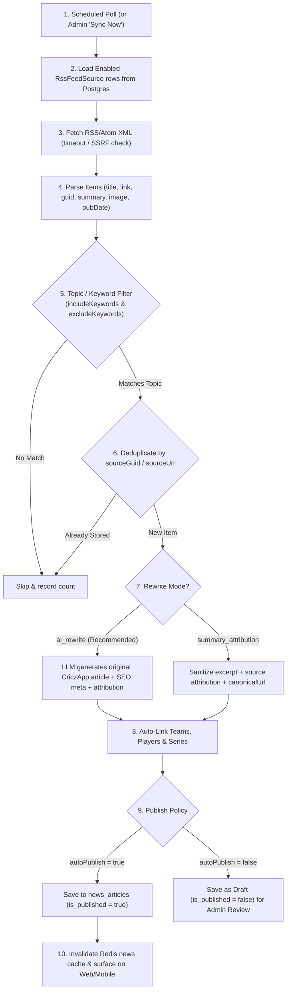

# RSS Feed Autoblogging Implementation Plan (Topic-Filtered)

## Goal Description

Implement a production-grade, **topic-filtered RSS autoblogging system** in CriczApp so the platform automatically discovers, filters, rewrites/attributes, categorizes, and publishes (or queues as drafts) cricket articles from curated RSS/Atom feeds on relevant topics (e.g., PSL, Pakistan Cricket, ICC tournaments, IPL, Test/T20/ODI news).

### Existing Foundation Extended
- **RSS/Atom fetcher & parser:** `services/ingestion/src/newsSync.js` (upgraded from static `NEWS_SOURCES` env var to Postgres-backed `rss_feed_sources`).
- **News & Entity Schema:** `apps/api/prisma/schema.prisma` (`NewsArticle`, `NewsCategory`, `Author`, `NewsArticleTeam`, `NewsArticlePlayer`, `NewsArticleSeries`).
- **LLM Narrative Provider:** `apps/api/src/common/narrative-provider.util.ts` (`openai` / `opencode` OpenAI-compatible client).

---

## End-to-End Autoblogging Procedure

---

## Architecture & Changes

### 1. Database Schema (`apps/api/prisma/schema.prisma`)
- `RssFeedSource` (`rss_feed_sources`): `name`, `url` (unique), `enabled`, `categoryId`, `authorId`, `includeKeywords` (`String[]`), `excludeKeywords` (`String[]`), `rewriteMode` (`ai_rewrite` | `summary_attribution` | `raw`), `autoPublish` (default `false`), `language`, `pollIntervalMinutes`, `maxItemsPerPoll`, `lastSyncedAt`, `lastStatus`, `lastError`, `articlesImported`.
- `NewsArticle`: add `sourceGuid` (unique) and `sourceUrl` for reliable deduplication and canonical attribution.

### 2. Backend Admin API (`apps/api/src/rss-feeds/`)
Protected by `JwtAuthGuard` + `AdminGuard`:
- `GET /api/admin/rss-feeds` — List all configured feeds with sync telemetry.
- `POST /api/admin/rss-feeds` — Create feed with SSRF-safe URL validation.
- `PATCH /api/admin/rss-feeds/:id` — Update feed settings, keywords, rewrite mode, or toggle enabled.
- `DELETE /api/admin/rss-feeds/:id` — Delete feed source (preserves already imported articles).
- `POST /api/admin/rss-feeds/preview` — Live-fetch feed URL, run topic filter, and preview matched vs skipped entries.
- `POST /api/admin/rss-feeds/:id/sync` — Trigger immediate sync for a single feed.

### 3. Ingestion Pipeline (`services/ingestion/src/`)
- `rssFilter.js`: RSS 2.0 + Atom parser, word-boundary topic keyword matcher (`includeKeywords` / `excludeKeywords`), strict HTML sanitizer, and media image extractor.
- `rssRewriter.js`: OpenAI-compatible (`opencode` / `openai`) editorial rewriter with automatic fallback to `summary_attribution`.
- `rssEntityLinker.js`: Auto-links matched `teams`, `players`, and `tournaments` into `news_article_teams`, `news_article_players`, and `news_article_series`.
- `newsSync.js`: Loads enabled `rss_feed_sources` from Postgres, respects per-feed intervals, deduplicates by `source_guid`/`source_url`, rewrites/attributes, auto-links entities, saves as draft or published, updates sync telemetry, and invalidates Redis cache.

### 4. Admin UI & Outbound RSS (`apps/web/`)
- `apps/web/src/app/(admin)/admin/rss-feeds/page.tsx` & `RssFeedManager.tsx`: Full CMS interface to manage feeds, test topic filters, and trigger manual syncs.
- `apps/web/src/app/rss.xml/route.ts`: Outbound RSS 2.0 feed of CriczApp's published articles (`?category=` supported).

---

## Verification Plan
- `node --test test/rssFilter.test.js test/newsSync.test.js` in `services/ingestion`
- `npm run build -w apps/api`
- `npm run typecheck -w apps/web`
- Manual QA in `/admin/rss-feeds` (Preview filter, Sync Now, verify deduplication and draft/published visibility).
